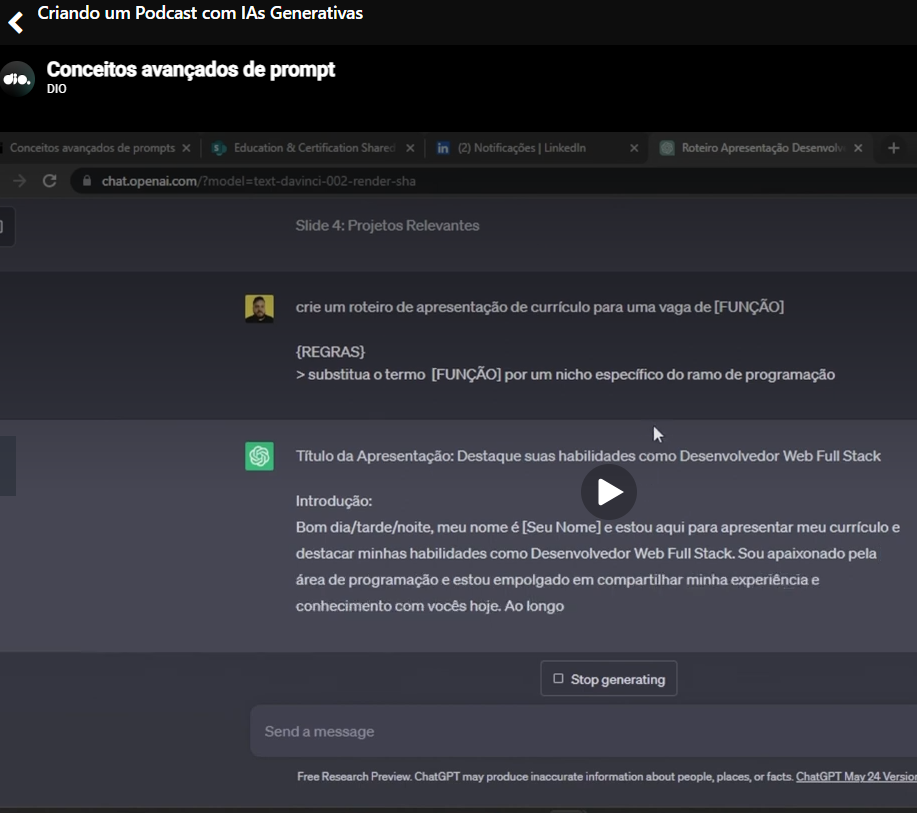
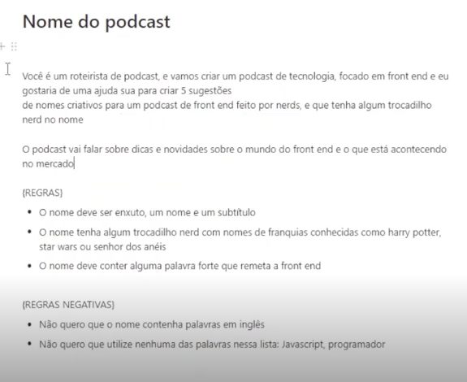
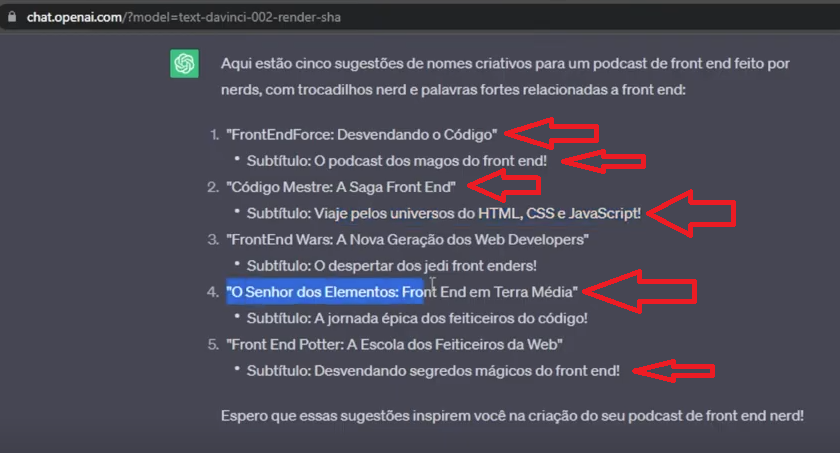
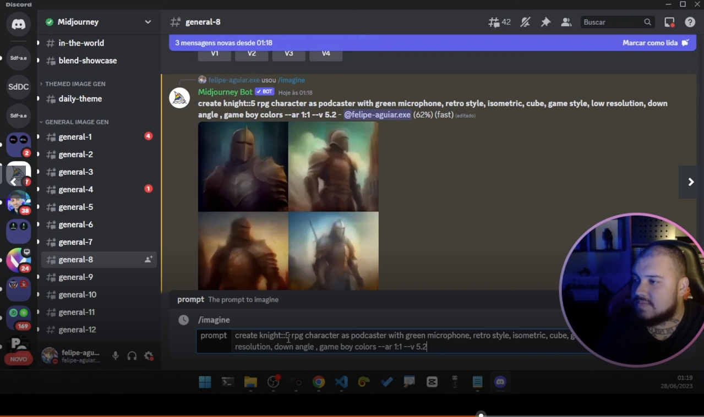

# Repository related to the classes

[link](https://github.com/felipeAguiarCode/prompts-for-podcast-generate-by-ia)

# Negative prompts

Related to ask the the model to do not produce something, link to ask to do not produce an image using the color blue.

# Passing of variables

# Prompt example - defining a podcast title

But, despite the instructions, teacher got unwanted results.

# Generating an image in Midjourney

In [this class](https://web.dio.me/lab/criando-um-podcast-com-ias/learning/94d1e79f-d215-471d-8eb6-eeee15332e95), teacher asked Midjourney to generate a cover image in Midjouney through Discord:

Midjourney nowdays only allow to generate images using a paid plan. But I will pass here some interesting Midjourney documentation links:

- [Parameters list](https://docs.midjourney.com/hc/en-us/articles/32859204029709-Parameter-List);
- [Weights](https://docs.midjourney.com/hc/en-us/articles/32658968492557-Multi-Prompts-Weights) - In the video teacher inserted in the prompt after a word :X (X is an integer number) to  specify the weight of the word in the prompt. Please see the documentation because seems that the syntax changed a little.

# [Current video](https://web.dio.me/lab/criando-um-podcast-com-ias/learning/29702401-84a2-44ee-b6a7-cda44cb70c6f?back=/play)